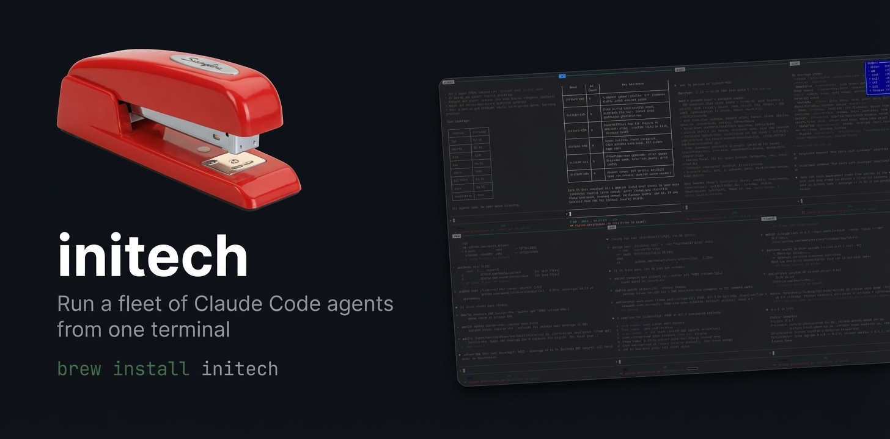

[](https://go.dev)
[](https://opensource.org/licenses/MIT)
[](https://github.com/nmelo/initech)
[](https://github.com/nmelo/homebrew-tap)
[](https://deepwiki.com/nmelo/initech)

<p align="center">
  
</p>

<strong>No tmux required!!</strong>

<!-- overview:start -->
initech runs a team of AI coding agents for you, each in its own terminal pane with a role, and keeps them coordinated so that you step in only for decisions.

- **Agents on more than one tool.** Claude Code by default, plus Codex and OpenCode panes, and agy or any other command as a generic pane. A message to any of them waits until the pane can take it.
- **One screen for the team.** A grid of panes with a status line each, a rig panel across the top with what needs you (blocked work, stale work, prompts waiting for an answer) and the rig's numbers, and layouts you switch with a key (focus, live, zoom, a second window).
- **Work as beads.** Every task is a bead in the bd tracker; agents claim, deliver and hand work on through it, and each pane shows its bead and its effort's pace.
- **Messages that never trample you.** `initech send` types into a pane only when its box is free, waits while you type in it, or while an agent is in do-not-disturb, and gives every held message a receipt you can withdraw.
- **Watches.** An agent hands initech a wait (a bead reaching a status, a comment, a send delivered, or a plain deadline) with a reason and a deadline, and gets one line back when it fires or misses. Option+T shows every watch in the rig.
- **Progress.** `initech progress` shows how an effort is moving: beads in flight, closes per hour, the critical path, and what is stuck or waiting.
- **Scheduled jobs.** `initech cron` puts a message or a short command into a pane on a schedule.
- **The list strip.** An agent pins a short list above its pane's bottom bar, such as what waits on you.
- **Your phone and tablet.** `initech app-serve` serves the initech iPhone and iPad app over your tailnet: your rigs and panes, what waits on you, progress, and a message to any agent.
- **Care of the machine.** Suspend and resume agents to free memory, a machine ceiling on how many run at once, `initech compact` to shrink an agent's context, and restarts.
- **More than one machine.** `initech serve` and `remote` run agents on another machine and show them here.
- **A team with roles.** super, pm, engineers, QA and a shipper, each with a charter, and one set of rules in the root CLAUDE.md.
<!-- overview:end -->

## Why

Running multiple Claude Code agents in tmux breaks in three specific ways:

- **Messages drop silently.** `tmux send-keys` has no delivery guarantee. When a completion report from eng to super drops, the dispatch chain stalls. initech's IPC socket confirms delivery or returns an explicit error.
- **Agent state is invisible.** A hung agent and a productive one look identical in tmux. initech shows every agent's activity state simultaneously — active, idle, stalled, or idle-with-work-waiting.
- **Work is invisible to the runtime.** tmux doesn't know what beads exist or who's working on what. initech parses Claude's session logs for bead events and surfaces them as typed notifications: green toast when an agent finishes, yellow when it stalls, red when it's error-looping.

## Quick Start

```bash
# Install
brew tap nmelo/tap && brew install initech

# Bootstrap a new project
mkdir myproject && cd myproject
initech init

# Launch
initech
```

`initech init` prompts for a project name, lets you pick roles interactively, and scaffolds the full workspace: `initech.yaml`, agent directories with CLAUDE.md files, git submodules, and project documents.

`initech` (no subcommand) launches the TUI. All agent panes start simultaneously.

<p align="center">
  <video src="https://github.com/user-attachments/assets/20a30a27-ea82-40e7-8f64-ee5a2adf2252" autoplay loop muted playsinline controls width="100%"></video>
</p>

## Features

- **Full PTY emulation** — each agent runs in a real terminal with VT100 support
- **Reliable IPC** — `initech send eng1 "message"` delivers or errors; no silent drops
- **Activity detection** — tracks byte flow per agent; idle-at-prompt is the only zero-output state
- **Bead integration** — parses Claude's JSONL session logs for `bd` commands; shows assignments in the ribbon
- **Toast notifications** — work state changes surface automatically, no agent cooperation required
- **Cross-machine support** — run agents across multiple machines; remote panes stream live over TCP
- **13 role templates** — super, pm, arch, eng, qa, shipper, sec, pmm, writer, ops, growth, and more
- **Any CLI per role** — run Claude Code, Codex, Amp, or any CLI side by side via `role_overrides` in `initech.yaml`
- **Command modal** — layout control, agent restart, patrol view, activity monitor, all from one bar

## Command Reference

```bash
initech send <role> "message"    # Deliver text to an agent
initech send host:role "message" # Deliver to an agent on another machine; reports its answer
initech peek <role> [-n lines]   # Read agent terminal output
initech patrol                   # All agents' output in one call
initech status                   # Agent table: activity, bead, alive
initech restart <role>           # Kill and respawn an agent
initech serve                    # Run headless daemon for remote connections
initech serve --show-token       # Print the daemon's stored token
initech peers                    # List connected machines and their agents
```

`initech serve` prints its token once, when it creates it; later starts say where it is stored (`.initech/token`), and `initech serve --show-token` prints it again. Never pass the token with `--token` in a shared shell: other users can read command lines.

Full CLI reference, configuration options, role catalog, and cross-machine setup: **[Operator Guide](docs/operator-guide.md)**

---

<p align="center">
  
</p>
